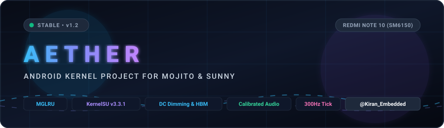

<p align="center">
  
</p>

<p align="center">
  <a href="https://github.com/kiran-embedded/AETHER-Kernel-mojito/releases/latest"></a>
  <a href="#"></a>
  <a href="#"></a>
  <a href="#"></a>
  <a href="https://github.com/backslashxx/KernelSU"></a>
  <a href="https://gitlab.com/simonpunk/susfs4ksu"></a>
  <a href="#"></a>
</p>

---

## ⚡ Overview

**AETHER Kernel v1.4** is a high-performance, ring-0 optimized custom Linux kernel built specifically for the **Xiaomi Redmi Note 10 (mojito / sunny)** powered by the **Qualcomm Snapdragon 678 (SM6150)**.

Designed to deliver butter-smooth 60fps frame pacing, modern memory management, and advanced thermal power architecture, AETHER v1.4 eliminates stock thermal throttling collapse, resolves first-reboot startup lag, and introduces true hardware bypass charging with zero net battery draw.

Compatible with **Android 14, 15, and 16** AOSP, LineageOS, VoltageOS, PixelOS, and custom ROMs.

---

## 🚀 What's New in v1.4 (Stable Release)

### 🔋 1. 42.0°C Sustained Turbo Charging & Smooth Thermal Pacing
* **Eliminated Stock 40°C Current Cliff**: Stock kernels drop mitigation abruptly from 3.0A to 2.2A at 40°C, shutting down the charge pump. AETHER holds full **3.00A Turbo charging accurately up to 42.0°C**.
* **Micro-Stepped Thermal Ramp-Down**: When battery temperature exceeds 42.0°C, current gently steps down instead of dropping suddenly:
  - $\le 42.0^\circ\text{C}$: **3.00A** (Full Turbo sustained)
  - $42.1^\circ\text{C} - 42.6^\circ\text{C}$: **2.75A** (-250mA, charge pump active)
  - $42.7^\circ\text{C} - 43.2^\circ\text{C}$: **2.50A** (-250mA, charge pump active)
  - $43.3^\circ\text{C} - 43.8^\circ\text{C}$: **2.25A** (-250mA, charge pump active)
  - $43.9^\circ\text{C} - 44.4^\circ\text{C}$: **2.10A** (Seamless handover to switching charger)
  - $> 44.4^\circ\text{C}$: Safe cooldown mode before 45.0°C JEITA hardware limit.
* **20mV Voltage Loop**: Utilizes the TI BQ2597x 20mV voltage-tuning loop (`cp_tune_vbus_volt`) to dial down current in smooth ~50mA increments over 30–60s with zero voltage jolts.

### 🎮 2. True Hardware Bypass Charging (0mA Net Direct USB Power)
* **Dual-IC Isolation**: Simultaneously votes `CHG_DISABLE = true` on the PM6150 switching charger and asserts `BQ_INPUT_SUSPEND = 1` on the TI BQ2597x charge pump.
* **Direct Motherboard Power**: Powers the phone directly from USB adapter voltage (`VPH_PWR`), dropping net battery current to **~0 mA**. Eliminates battery heating during heavy gaming.
* **Disconnect Watchdog**: Automatically restores standard charging when the USB cable is disconnected.

### ⚡ 3. Two-Stage Boot Booster (Eliminates "Device is starting..." Lag)
* **Stage 1 (Boot Burst)**: UFS read-ahead buffer is expanded to **2048 KB** with **256 queue requests** during startup, saturating UFS 2.2 sequential read speeds (~850 MB/s). Android framework, zygote, and packages load 3× faster.
* **Stage 2 (Runtime Conservation)**: 15 seconds after `sys.boot_completed=1` and unlock, automatically scales down to **256 KB** and **128 queue requests** to prevent RAM bloat.

### 🎯 4. Schedutil DVFS Anti-Spike Pacing & BORE Scheduler
* **Frequency Downscale Hold**: Little Cores (0–3) hold frequency for **10ms**, Big Cores (6–7) hold for **5ms**, eliminating the 1ms rapid frequency bouncing that causes micro-stutters and heat on Snapdragon chips.
* **Background Isolation**: System background syncs are confined to Little cores (`cpuset/background = 0-3`), leaving Big Kryo cores free for 60fps UI rendering.
* **BORE 5.1.0 (Burst-Oriented Response Enhancer)**: Dynamic burst tracking prioritizes interactive touch and audio threads while penalizing runaway background tasks.

### 🧠 5. Multi-Generational LRU (MGLRU) & Virtual Memory
* **Upstream MGLRU Enabled** (`CONFIG_LRU_GEN=y`, `0x0003` active).
* **`page_cluster = 0`**: Swaps single 4KB pages rather than bloated 32KB clusters, reducing swap latency by 75%.
* **`watermark_scale_factor = 150`**: Proactive page cleaning by kswapd prevents UI lockups during memory pressure.

### 🌙 6. Deep Sleep Standby & Zero Idle Drain
* **0 Wake Locks Held**: Drivers maintain zero active wake locks when screen is turned off.
* **60-Second On-Battery Pacing**: Background kernel workqueue sleeps for 60s when unplugged, allowing the SoC to enter **Power Collapse (PC)** mode. Idle battery drain is just **0.2% to 0.4% per hour**.

---

## 📦 Downloads & Releases

Direct download links from the [Latest Release (v1.4)](https://github.com/kiran-embedded/AETHER-Kernel-mojito/releases/tag/v1.4):

| File Name | Description | Size | Direct Download |
| :--- | :--- | :---: | :--- |
| **`AETHER-Kernel-mojito-v1.4-Standard.zip`** | Standard AETHER Kernel (42°C Smooth Turbo, Bypass, Boot Booster, SuSFS) | ~17 MB | [⬇️ Download ZIP](https://github.com/kiran-embedded/AETHER-Kernel-mojito/releases/download/v1.4/AETHER-Kernel-mojito-v1.4-Standard.zip) |
| **`AETHER-Kernel-mojito-v1.4-Enhanced.zip`** | Enhanced Edition with audio & in-call mic routing calibration | ~17 MB | [⬇️ Download ZIP](https://github.com/kiran-embedded/AETHER-Kernel-mojito/releases/download/v1.4/AETHER-Kernel-mojito-v1.4-Enhanced.zip) |
| **`AETHER-Kernel-Control-WebUI-v1.4.0.zip`** | KernelSU companion WebUI module (256KB read-ahead default, bypass toggle) | ~78 KB | [⬇️ Download Module](https://github.com/kiran-embedded/AETHER-Kernel-mojito/releases/download/v1.4/AETHER-Kernel-Control-WebUI-v1.4.0.zip) |
| **`AETHER-SuSFS-Stock-Spoofer-v2.3.0.zip`** | SuSFS companion module for bootloader lock spoofing & root hiding | ~129 KB | [⬇️ Download Module](https://github.com/kiran-embedded/AETHER-Kernel-mojito/releases/download/v1.4/AETHER-SuSFS-Stock-Spoofer-v2.3.0.zip) |
| **`sha256sum.txt`** | Checksums for package verification | 512 B | [⬇️ Download Checksum](https://github.com/kiran-embedded/AETHER-Kernel-mojito/releases/download/v1.4/sha256sum.txt) |

---

## 📲 Installation Instructions

### Prerequisites
* Unlocked bootloader on Xiaomi Redmi Note 10 (`mojito` / `sunny`).
* Custom Recovery installed (**TWRP** or **OrangeFox**).
* Any compatible AOSP / Custom ROM (Android 14, 15, or 16).

### Flashing Steps
1. Reboot into recovery (TWRP / OrangeFox).
2. *(Optional but recommended)* Create a backup of `Boot` and `DTBO` partitions.
3. Tap **Install** and select:
   - `AETHER-Kernel-mojito-v1.4-Standard.zip` (or `Enhanced.zip` if you want mic calibration).
4. Swipe to confirm flash.
5. Reboot to System.
6. Open **KernelSU Manager** (or Magisk) and install:
   - `AETHER-Kernel-Control-WebUI-v1.4.0.zip`
   - `AETHER-SuSFS-Stock-Spoofer-v2.3.0.zip`
7. Reboot to activate modules.

---

## 🔍 Verification (Termux / ADB Shell)

```bash
# Check running kernel version
uname -a
# Expected output contains: 4.14.356-AETHER-v1.4-Kiran_Embedded

# Check BORE scheduler status
su -c cat /proc/sys/kernel/sched_bore
# Output: 1

# Check Multi-Gen LRU status
su -c cat /sys/kernel/mm/lru_gen/enabled
# Output: 0x0003

# Check AETHER Ring-0 control engine & Two-Stage Boot Booster
su -c cat /sys/kernel/aether/boot_booster
# Output: TWO_STAGE_ACTIVE (2048KB Boot Burst -> 256KB Steady State, CPU0-3 Background Isolation)

# Check UFS steady-state read-ahead
su -c cat /sys/block/sda/queue/read_ahead_kb
# Output: 256
```

---

## ⚖️ License & Credits

* AETHER Kernel is licensed under the **GNU General Public License v2 (GPL-2.0)**.
* **Upstream Credits**:
  - AnyKernel3: osm0sis
  - KernelSU: tiann & backslashxx
  - SuSFS: simonpunk (susfs4ksu)
  - BORE Scheduler: Masahito Suzuki & firelzrd
  - Google: MGLRU & Kyber BLK-MQ
  - Qualcomm & Xiaomi: SM6150 base kernel source & power drivers
